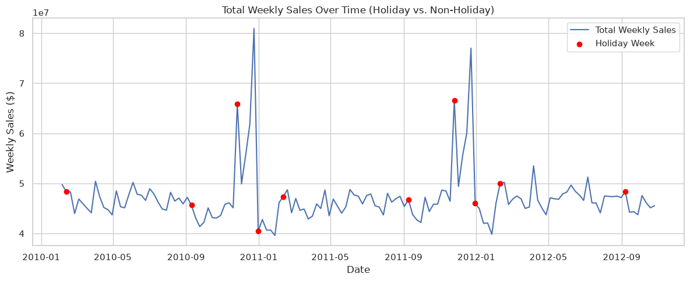
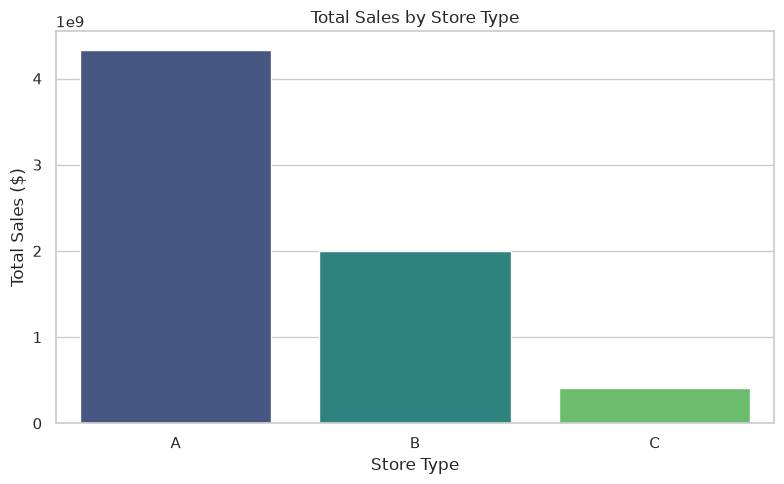
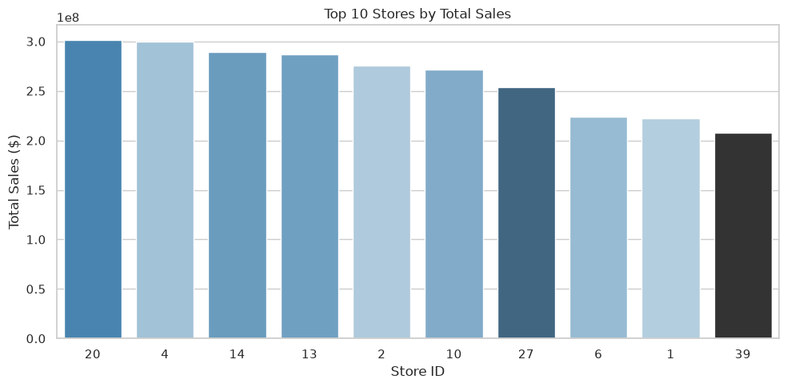
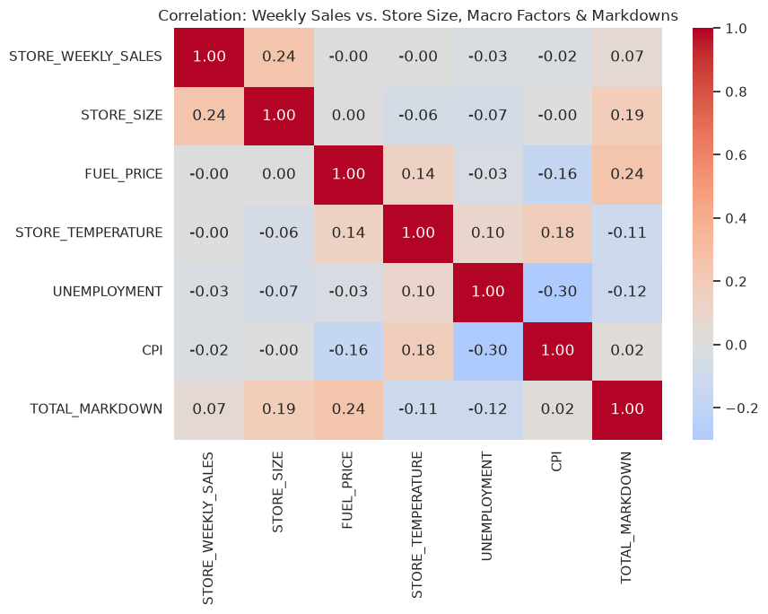

# Walmart BI Data Analysis (Snowflake + dbt + Python)

End-to-end Business Intelligence pipeline analyzing Walmart retail store and department sales across macroeconomic indicators, store types, and holiday periods.

## Architecture & Tech Stack
- **Data Warehouse:** Snowflake (`WALMART_DB.RAW` -> `WALMART_DB.DBT_DEV`)
- **Transformation & Modeling:** dbt Cloud (Star Schema with SCD Type 1 & SCD Type 2)
- **Reporting & Visualization:** Python (Snowpark, pandas, Matplotlib, Seaborn)

## Data Model (`WALMART_DB.DBT_DEV`)
- **`walmart_date_dim` (SCD Type 1):** Date dimension tracking `Date_id`, `Store_Date`, `Isholiday`, and audit timestamps.
- **`walmart_store_dim` (SCD Type 1):** Store dimension tracking `Store_id`, `Dept_id`, `Store_type`, `Store_size`, and audit timestamps.
- **`walmart_fact_table` (SCD Type 2):** Fact table storing weekly sales, fuel price, temperature, unemployment, CPI, and markdowns (`Markdown1`–`Markdown5`) with `vrsn_start_date` and `vrsn_end_date` version tracking.

## Visual Reports (`walmart_analysis_reports.py`)

### 1. Weekly Sales Trend Over Time

### 2. Total Weekly Sales by Store Type (A, B, C)

### 3. Top 10 Stores by Weekly Sales

### 4. Correlation Heatmap

